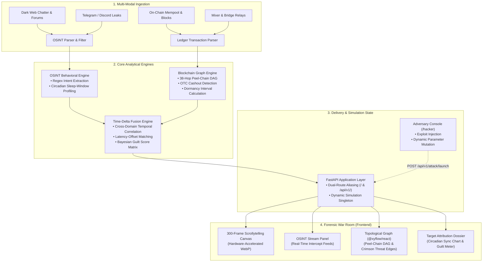

<p align="center">
  
</p>

<h1 align="center">PARALLAX</h1>
<h3 align="center">Project RedString — Quantitative OSINT Blockchain Forensics Engine</h3>

<p align="center">
  <em>Connecting Dark Web Chatter to On-Chain Blockchain Transactions for Real-Time Threat Attribution & Deanonymization.</em>
</p>

<p align="center">
  
  
  
  
  
  
  
</p>

---

## 📸 Interface Showcase

<p align="center">
  
</p>
<p align="center">
  <em>Figure 1: Parallax Forensic War Room — Live Cyberpunk UI with Hardware-Accelerated 3D Scrollytelling, $42M Threat Counter, and Adversary Console Launcher.</em>
</p>

---

## 🎯 Problem Statement

The decentralized finance (DeFi) ecosystem suffers billions of dollars in annual losses from complex smart contract exploits, flash-loan oracle manipulations, and treasury multi-sig breaches. 

Once an exploit executes, bad actors employ sophisticated money laundering tactics:
1. **Peel-Chain Fracturing**: Systematically splitting stolen funds across 30+ intermediate "burner" wallets in micro-transactions to overwhelm forensic scrapers.
2. **Obfuscation Protocols & Mixers**: Routing funds through privacy pools (Tornado Cash, Railgun, Bitzlato OTC, and atomic swaps to privacy coins like Monero).
3. **The Cryptographic Impasse**: On-chain ledger analysis alone yields only pseudonymous wallet addresses and transaction hashes. Once funds hit mixers or OTC cashout points, traditional blockchain tracking hits a brick wall.

Meanwhile, attackers operate in the physical world:
- They boast on Telegram channels and dark web forums.
- They upload proof-of-concept scripts to pseudonymous GitHub repositories.
- They operate within specific physical timezones, exhibiting inescapable biological circadian sleep cycles.

**The Disconnect**: Threat intelligence teams analyze dark web OSINT in silos, while blockchain analysts analyze ledger graphs in isolation. There is no automated, quantitative system linking unstructured off-chain chatter with on-chain transaction graph dynamics in real time.

---

## 💡 Proposed Solution

**PARALLAX (Project RedString)** is a quantitative OSINT-blockchain correlation engine that fuses unstructured textual threat signals with mathematical on-chain ledger topology to deanonymize exploit cashouts with high statistical confidence.

### Core Innovations:
- **Time-Delta Fusion Engine**: Quantifies temporal correlation between forum boasts, code commits, and block timestamps down to millisecond offsets.
- **Circadian Dormancy Sync**: Reconstructs an adversary's biological sleep schedule (e.g., 7-hour daily dormancy window) by cross-referencing message frequencies against blockchain silence periods, isolating the attacker's physical timezone (e.g., UTC+3 Moscow).
- **Topological Peel-Chain DAG Engine**: Automatically unpacks complex peel-chains into Directed Acyclic Graphs (`@xyflow/react`), highlights 38+ hop matrices, and flags OTC off-ramp gateways.
- **Empirical Guilt Attribution Matrix**: Multi-factor scoring engine evaluating timing proximity, keyword signatures, and cashout routing to output an evidentiary confidence rating (e.g., 94.8% Guilt Index).
- **Interactive Adversary Exploit Simulator (`/hacker`)**: A dedicated black-hat adversary console enabling real-time injection of arbitrary exploit parameters, instantly updating the global forensic state.

---

## 🔬 Technical Approach



---

## 🛠️ Full Backend Structure Explained

The backend is built with Python 3.10+ and FastAPI, designed with modular directory isolation and clean separation of analytical responsibilities:

```
backend/
├── main.py                          # Compatibility entry point (supports uvicorn execution from root or /backend)
├── requirements.txt                 # Core dependencies (FastAPI, NetworkX, Pandas, Uvicorn, etc.)
│
├── api/
│   ├── __init__.py                  # Package initialization
│   ├── main.py                      # Production FastAPI server, CORS middleware, and dual-prefix routers
│   └── simulation.py                # In-memory Attack Simulation Engine singleton & dynamic state mutator
│
├── osint_engine/
│   ├── __init__.py                  # Package initialization
│   ├── parser.py                    # NLP regex parser, intent classifier, and author footprint generator
│   └── sleep_cycle.py               # Circadian sleep-window aggregator and 24-hour UTC activity profiler
│
├── blockchain_engine/
│   ├── __init__.py                  # Package initialization
│   ├── graph_builder.py             # NetworkX DAG graph constructor, hop calculator, and cashout classifier
│   └── dormancy.py                  # On-chain transaction silence interval detector
│
├── correlation_engine/
│   ├── __init__.py                  # Package initialization
│   ├── correlator.py                # Mathematical fusion scoring engine & suspect leaderboard generator
│   └── timeline_builder.py          # Unified multi-axis chronological timeline intertwining OSINT & Ledger
│
├── tracker/
│   ├── attack_generator.py          # Synthetic dynamic exploit and transaction graph generator
│   ├── correlation_engine.py        # Graph-based wallet correlation routines
│   ├── fracture_engine.py           # Multi-hop peel-chain splitting and burner wallet dispatcher
│   ├── guilt_engine.py              # Multi-factor evidentiary confidence scoring algorithm
│   └── timing_engine.py             # Puppeteer cluster detector and burst-activity analyzer
│
├── data/
│   └── raw/
│       ├── osint_chatter.json       # 1,000+ synthetic dark web messages across Telegram, DarkWeb, Discord
│       ├── blockchain_txs.json      # Structured multi-hop transactions with genesis vault exploits
│       └── generate_mock_data.py    # Deterministic dataset generation script
│
└── tests/
    └── test_simulation.py           # Automated test suite validating API schema and simulation lifecycles
```

### Deep Dive: Backend Modules

#### 1. API Delivery Layer (`backend/api/`)
- **`api/main.py`**:
  - Registers all operational endpoints under dual route prefixes (`/` and `/api/v1/`) to ensure complete compatibility regardless of client calling convention.
  - Implements open CORS policies with standard response middleware.
  - Automatically routes requests through the simulation engine state if an attack simulation is active.
- **`api/simulation.py`**:
  - Encapsulates the `SimulationEngine` stateful singleton.
  - When an attack is triggered via `/api/v1/attack/launch`, it dynamically generates a customized attacker profile (`@Phantom_0x`, `@Judge_Smith`, etc.), shifts dormancy windows, injects exploit transactions into the ledger, and promotes the attacker to rank #1 on the suspect leaderboard.
  - Supports `/api/v1/simulation/reset` to revert the system to baseline standby monitoring.

#### 2. OSINT Behavioral Engine (`backend/osint_engine/`)
- **`osint_engine/parser.py`**:
  - Applies targeted regex rules and lightweight lexical NLP to extract intent flags (`PANIC`, `BRAGGING`, `LEAK`, `RECONNAISSANCE`).
  - Aggregates messages by author alias, extracting message frequency, primary language tokens, and source platforms.
- **`osint_engine/sleep_cycle.py`**:
  - Groups message timestamps into 24 one-hour UTC bins.
  - Identifies continuous 6-to-8-hour windows of near-zero posting frequency to determine biological sleep schedules, translating inactivity windows into probable physical timezones.

#### 3. Blockchain Engine (`backend/blockchain_engine/`)
- **`blockchain_engine/graph_builder.py`**:
  - Ingests raw transaction arrays and constructs Directed Acyclic Graphs (DAGs) using NetworkX.
  - Calculates hop metrics (Genesis $\rightarrow$ Layer 1 Split $\rightarrow$ Layer 2 Peel $\rightarrow$ Layer 3 Mixer).
  - Tags termination addresses with cashout classifications (`CASH_OUT_DOOR`, `TORNADO_RELAY`, `BITZLATO_OTC`).
- **`blockchain_engine/dormancy.py`**:
  - Computes time gaps between outgoing wallet transactions to identify on-chain dormancy periods.

#### 4. Correlation & Attribution Engine (`backend/correlation_engine/`)
- **`correlation_engine/correlator.py`**:
  - Fuses the sleep cycles from `osint_engine` with the wallet dormancy windows from `blockchain_engine`.
  - Computes an empirical guilt score based on:
    $$\text{Guilt Score} = w_1 \cdot \text{Sleep Sync} + w_2 \cdot \text{Time Delta} + w_3 \cdot \text{Keyword Hits} + w_4 \cdot \text{Routing Proximity}$$
  - Generates the ranked suspect leaderboard.
- **`correlation_engine/timeline_builder.py`**:
  - Merges disparate OSINT events and on-chain transactions into a single unified chronological timeline for investigative reconstruction.

#### 5. Threat Tracking & Simulation Utilities (`backend/tracker/`)
- **`tracker/timing_engine.py`**: Detects puppeteer clusters and automated transaction scripts.
- **`tracker/fracture_engine.py`**: Simulates peel-chain fractures into arbitrary burner wallet depths.
- **`tracker/attack_generator.py`**: Synthesizes custom adversary telemetry on the fly.

---

## 💻 Frontend War Room Architecture

The frontend is a dark, cinematic UI inspired by modern tactical dashboards and intelligence war rooms:

### 1. Zero-Lag 300-Frame Scrollytelling Canvas
- **Hardware-Accelerated WebP**: Extracts and loads 300 optimized WebP frames (`public/frames/`), drawing them to a sticky HTML5 `<canvas>` via `requestAnimationFrame`.
- **Framer Motion Integration**: Hooks `scrollYProgress` smoothly into the 300-frame video sequence, providing buttery 60 FPS scrubbing across three narrative stages.
- **Word-Reveal Narrative (`skiper70`)**: Sticky scroll-tied typography revealing the incident report word-by-word with specular text sheen.

### 2. 3-Column Stepped Workbench Hierarchy (25% / 50% / 25%)
- **Panel 1 (Left 25% — OSINT Stream)**: Real-time intelligence feed showcasing captured forum posts, author handles, timestamps, and flagged threat tags.
- **Panel 2 (Center 50% — Topological Graph)**: Powered by `@xyflow/react`, rendering an interactive DAG of the 38-hop peel-chain matrix with animated crimson threat edges (`#dc2626`) and tactical amber cashout gateways.
- **Panel 3 (Right 25% — Target Attribution Dossier)**: Displays the primary suspect profile, animated guilt percentage meter, proof vector logs, and a 24-hour SVG circadian sleep-cycle histogram highlighting the physical timezone sync window (04:00 – 11:00 UTC).

### 3. Adversary Exploit Injection Console (`/hacker`)
- Accessible directly at `/hacker` or via the floating bottom-right launcher.
- **Liquid Glassmorphism**: Ambient moving red gradient mesh with two orbiting blurred radial light orbs (`w-[600px]` & `w-[700px]`), frosted glass panels with specular gleam lines, and glass input controls.
- **7 Live Attack Controls**:
  1. Attacker Handle / Forum Alias (with quick-fill `@Judge_Smith`)
  2. Circadian Sleep Schedule (Moscow UTC+3, New York UTC-5, Tokyo UTC+9)
  3. Intercepted Boast / Leak Payload textarea
  4. Smart Contract Vulnerability Target (Reentrancy, Flash Loan Oracle, Multisig Bypass)
  5. Capital Drained USD input with preset pills ($10M, $42M, $100M)
  6. Obfuscation Protocol / Mixer Route (Railgun, Tornado Cash, Cross-Chain Monero)
  7. Peel-Chain Fracture Depth range slider (10 to 50 wallets)
- **Execution & Auto-Routing**: Broadcasts live payloads to the backend mempool, displays execution confirmation, and routes to `/?breach=true` to automatically load live forensic countermeasures in the War Room.

---

## 📡 API Endpoint Reference

All endpoints are accessible with both `/api/v1/` and non-prefixed `/` routes:

| Method | Endpoint | Description |
|---|---|---|
| `GET` | `/api/v1/health` | Service health status and active simulation indicator |
| `GET` | `/api/v1/osint/feed` | List of intercepted OSINT posts with source tags and keywords |
| `GET` | `/api/v1/blockchain/nodes` | 38-hop Directed Acyclic Graph nodes and edge relationships |
| `GET` | `/api/v1/correlation/timeline` | Synchronized chronological timeline of OSINT & ledger events |
| `GET` | `/api/v1/suspects/leaderboard` | Ranked suspects with guilt percentages and 24h sleep histograms |
| `POST` | `/api/v1/attack/launch` | Injects custom attack simulation parameters into memory |
| `GET` | `/api/v1/alerts/latest` | Status of active heist alerts and security breaches |
| `POST` | `/api/v1/simulation/reset` | Resets active simulation back to idle baseline monitoring |

---

## 🚀 Quickstart Guide

### Prerequisites
- **Python**: 3.10 or higher
- **Node.js**: 18.0 or higher
- **npm**: 9.0 or higher

### 1. Clone Repository
```bash
git clone https://github.com/amishiverma/HackForge_MindOverMatter.git
cd HackForge_MindOverMatter
```

### 2. Backend Setup
```bash
# Navigate to backend directory
cd backend

# Install dependencies
pip install -r requirements.txt

# Start the FastAPI engine (Port 8000)
uvicorn api.main:app --reload --port 8000
```
*API documentation will be available at `http://localhost:8000/docs`.*

### 3. Frontend Setup
```bash
# In a new terminal, navigate to frontend directory
cd frontend

# Install dependencies
npm install

# Launch Vite development server (Port 5173)
npm run dev
```

### 4. Experience the Platform
- **Main Investigation War Room**: Open [http://localhost:5173](http://localhost:5173) in your browser.
- **Forensic Workbench**: Navigate to [http://localhost:5173/?breach=true](http://localhost:5173/?breach=true) or click **"Forensic Workbench"** on the floating navigation bar.
- **Adversary Exploit Console**: Open [http://localhost:5173/hacker](http://localhost:5173/hacker) to configure and execute real-time attack simulations.

---

## 👥 The Team — Mind Over Matter

Developed for **HackForge 2026**:

| Team Member | Role | Core Contributions |
|---|---|---|
| **Amishi Verma** | Frontend Weaver | Next.js/React 19 War Room, 300-frame Canvas Scrollytelling, Peel-Chain DAG Flow, Liquid Glassmorphism, `/hacker` Adversary Console |
| **Yash Mhatre** | OSINT Investigator | Python NLP regex extraction, circadian sleep-window analysis, dark web chatter ingestion |
| **Sanchita** | Blockchain Tracker & Correlator | Web3 transaction graph algorithms, 38-hop peel-chain analysis, time-delta fusion scoring |

---

<p align="center">
  <sub>Built with precision for HackForge 2026. Project RedString © 2026. All rights reserved.</sub>
</p>